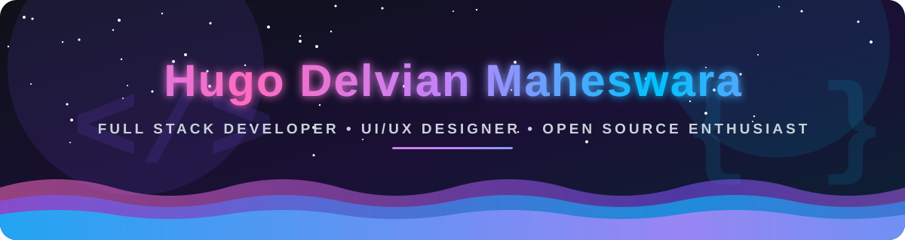
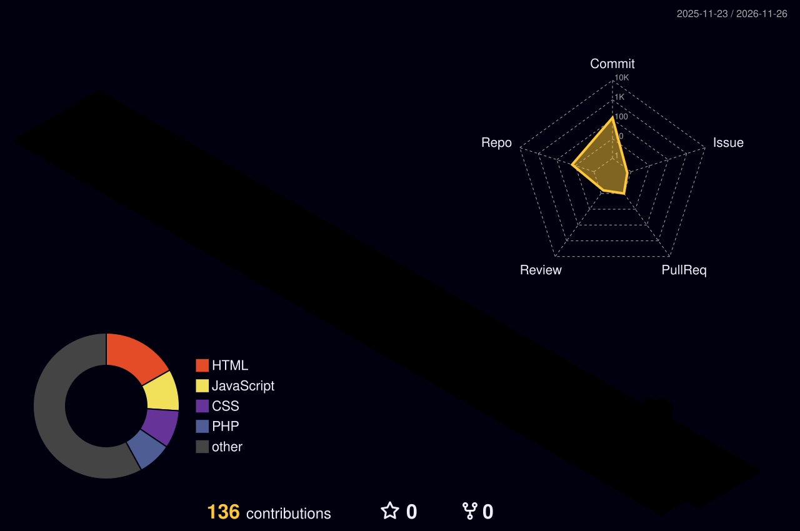

<div align="center">



<a href="https://github.com/Hugo-Code21">
  
</a>


</div>

---

## 👋 About

<table>
<tr>
<td width="55%" valign="top">

I'm **Hugo**, a developer from Indonesia sitting right between **design** and **code**. I prototype in Figma, then bring it to life with clean, fast, accessible front-ends and solid back-ends. Right now I'm digging into **systems programming**, because knowing what happens under the hood makes me better at every level of the stack.

> 💡 *"Good software looks great, feels fast, and is built forever."*

🎨 **Design with care** · ⚙️ **Build it right** · 🌍 **Share it openly**

</td>
<td width="45%" valign="top">

```yaml
name:     Hugo Delvian Maheswara
location: Indonesia 🇮🇩
roles:    [Full Stack Dev, UI/UX, Graphic Design]
os:       Windows, Mobile
focus:    [HTML5, CSS3, PHP, JS, TS, React]
learning: Advanced Systems Programming
hobbies:  [Coding, Music, Games]
```

</td>
</tr>
</table>

**🔄 Workflow:** 💡 Idea → ✏️ Design (Figma) → 💻 Code → 🚀 Deploy → 🔁 Iterate

---

## 🚧 Currently

| | |
|---|---|
| 🛠️ **Working on** | Web, Mobile Project, Graphic Design |
| 📚 **Learning** | Advanced Systems Programming, TypeScript & React |
| ✏️ **Designing** | UI System in Figma |
| 🤝 **Open to** | Open source collaboration, freelance projects & hire |
| 💬 **Ask me about** | HTML, CSS, JavaScript, PHP, Kotlin, UI/UX, Graphic Design |

---

## 🧰 Tech Arsenal

**Frontend & Mobile** &nbsp;


**Backend** &nbsp;


**Databases** &nbsp;


**Hosting** &nbsp;


**Design** &nbsp;


**Tools** &nbsp;


---

## 📊 Stats

<div align="center">


</div>

<details>
<summary><b>🏙️ Activity graphs (3D city, contributions &amp; snake)</b></summary>
<br/>




</details>

---

## 🎶 Now Playing

<div align="center">



[](https://open.spotify.com/search/Helena%20My%20Chemical%20Romance)
[](https://www.youtube.com/results?search_query=My+Chemical+Romance+Helena)

<sub>Helena, this one's always stuck inside of the deepest of all memory of mine.</sub>

</div>

---

## 💌 Let's Connect

<div align="center">

<sub>Got an idea, a project, or just want to say hi? My inbox is always open.</sub>

[](https://github.com/Hugo-Code21)
[](mailto:hugomaheswaradev@gmail.com)
[](https://www.instagram.com/sudo.desdev/)


</div>
